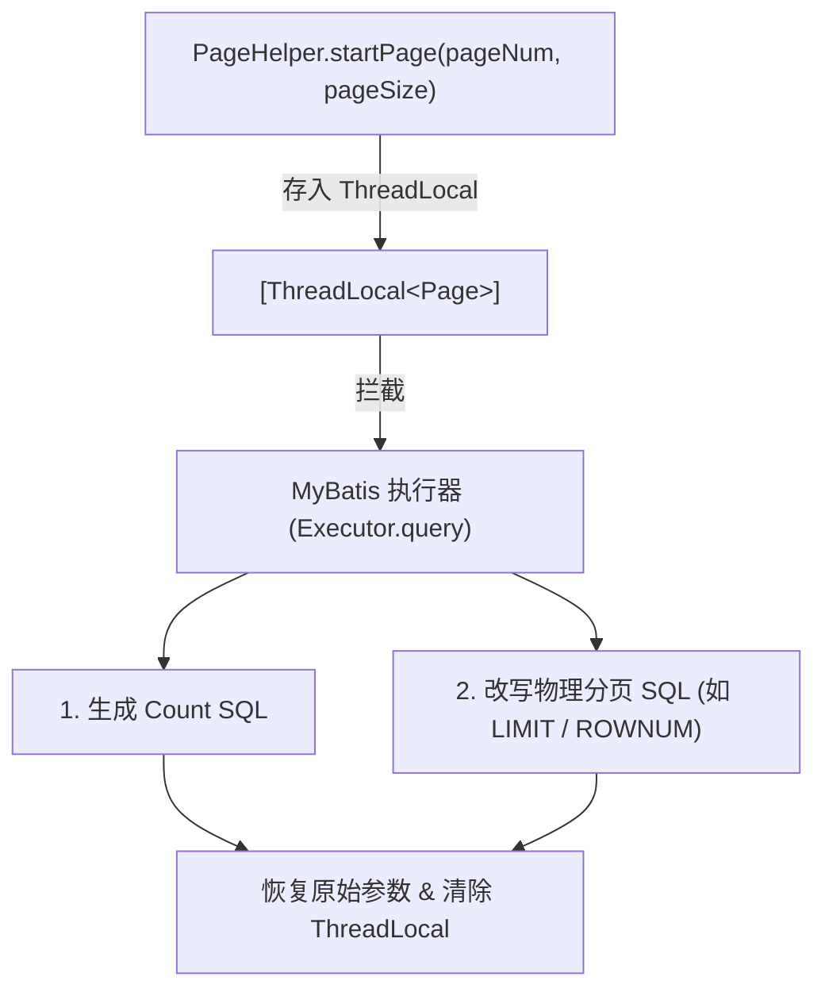

# 分页操作

MyBatis 中的分页是指在查询大量数据库数据时，为了避免一次性加载过多数据导致内存溢出或响应缓慢，将结果集切分为若干页，按需拉取指定区间的记录。


## limit 分页

使用 SQL 的 `limit` 关键字是实现物理分页（在数据库引擎层截断数据）最直接、最有效的方式。

在 MySQL 等支持 `limit` 的数据库中，语法为：

```sql
select * from user limit offset, pagesize;
```

- `pagesize`：每页展示的记录条数

- `offset`：起始偏移量，公式为：
  $$
  offset = (pageNum - 1) × pageSize
  $$


### 默认参数名

MyBatis 对多参数方法默认会封装成 `ParamMap`，key 是 `param1`（或 `arg0`）、`param2`（或 `arg1`），不是参数名。

::: code-group

```java [SysUserMapper]
public interface SysUserMapper {
  /**
   * 查询所有用户
   *
   * @param offset   偏移量
   * @param pageSize 每页条数
   * @return 用户集合
   */
  List<SysUser> selectAll(int offset, int pageSize);
}
```

```xml {8} [SysUserMapper.xml]
<?xml version="1.0" encoding="UTF-8"?>
<!DOCTYPE mapper
        PUBLIC "-//mybatis.org//DTD Mapper 3.0//EN"
        "https://mybatis.org/dtd/mybatis-3-mapper.dtd">
<mapper namespace="com.example.mapper.SysUserMapper">

  <select id="selectAll" resultType="com.example.pojo.SysUser">
    select * from sys_user limit #{param1}, #{param2}
  </select>

</mapper>
```

:::


### @Param 命名（推荐）

上面使用默认参数名的方式不利于阅读和维护，因此可以使用 `@Param()` 注解，给每个参数起别名。

::: code-group

```java {9} [SysUserMapper]
public interface SysUserMapper {
  /**
   * 查询所有用户
   *
   * @param offset   偏移量
   * @param pageSize 每页条数
   * @return 用户集合
   */
  List<SysUser> selectAll(@Param("offset") int offset, @Param("pageSize") int pageSize);
}
```

```xml [SysUserMapper.xml]
<?xml version="1.0" encoding="UTF-8"?>
<!DOCTYPE mapper
        PUBLIC "-//mybatis.org//DTD Mapper 3.0//EN"
        "https://mybatis.org/dtd/mybatis-3-mapper.dtd">
<mapper namespace="com.example.mapper.SysUserMapper">

  <select id="selectAll" resultType="com.example.pojo.SysUser">
    select * from sys_user limit #{offset}, #{pageSize}
  </select>

</mapper>
```

```java [单元测试]
public class AppTest {
  @Test
  @DisplayName("查询所有用户")
  void testSelectAll() {
    SqlSession sqlSession = MyBatisUtils.getSqlSession();
    SysUserMapper mapper = sqlSession.getMapper(SysUserMapper.class);

    int pageNum = 1; // 第一页
    int pageSize = 2; // 每页两条
    int offset = (pageNum - 1) * pageSize;

    List<SysUser> sysUsers = mapper.selectAll(offset, pageSize);
    sysUsers.forEach(System.out::println);
  }
}
```

:::


### 封装为对象

当参数较多时，把 pageSize 和 pageNum 封装到一个对象中，XML 里用 `#{offset}` 和 `#{pageSize}` 就能识别。

::: code-group

```java [SysUserMapper]
public interface SysUserMapper {
  /**
   * 查询所有用户
   *
   * @param pageParam 分页参数
   * @return 用户集合
   */
  List<SysUser> selectAll(PageParam pageParam);
}
```

```java [PageParam]
@Data
@AllArgsConstructor
public class PageParam {
  private Integer offset;

  private Integer pageSize;
}
```

```xml [SysUserMapper.xml]
<?xml version="1.0" encoding="UTF-8"?>
<!DOCTYPE mapper
        PUBLIC "-//mybatis.org//DTD Mapper 3.0//EN"
        "https://mybatis.org/dtd/mybatis-3-mapper.dtd">
<mapper namespace="com.example.mapper.SysUserMapper">

  <select id="selectAll" resultType="com.example.pojo.SysUser">
    select * from sys_user limit #{offset}, #{pageSize}
  </select>

</mapper>
```

```java {12} [单元测试]
public class AppTest {
  @Test
  @DisplayName("查询所有用户")
  void testSelectAll() {
    SqlSession sqlSession = MyBatisUtils.getSqlSession();
    SysUserMapper mapper = sqlSession.getMapper(SysUserMapper.class);

    int pageNum = 1; // 第一页
    int pageSize = 2; // 每页两条
    int offset = (pageNum - 1) * pageSize;
    // 归一到分页参数中
    PageParam pageParam = new PageParam(offset, pageSize);

    List<SysUser> sysUsers = mapper.selectAll(pageParam);
    sysUsers.forEach(System.out::println);
  }
}
```

:::


## RowBounds 分页

RowBounds 是 MyBatis 提供的逻辑分页（内存分页）方式，不需要在 SQL 中写 `limit`，MyBatis 会在结果集中返回后帮你截取。

MyBatis 会自动识别 `RowBounds` 类型的参数，**不需要 `@Param`**，也不参与 `#{...}` 绑定。

> [!WARNING] 注意
>
> RowBounds 分页会存在严重的性能风险，MyBatis 的处理方式是先把 **所有符合条件的记录查出来放到内存**，再从中截取 offset ~ offset + limit 的部分。
>
> 也就是说，即使你只需要第 1 页前 5 条，SQL 实际执行的是：
>
> ```sql
> select * from sys_user; -- 查出全表！
> ```
>
> 然后 MyBatis 在 `ResultSet` 上跳过 `offset` 行，取 `limit` 行。
>
> 当数据量非常大时，内存和性能都会严重受到影响，和真正的物理分页（SQL 带 `limit`）差距巨大。

::: code-group

```java [SysUserMapper]
public interface SysUserMapper {
  /**
   * 查询所有用户
   *
   * @param rowBounds mybatis 分页参数
   * @return 用户集合
   */
  List<SysUser> selectAll(RowBounds rowBounds);
}
```

```xml [SysUserMapper.xml]
<?xml version="1.0" encoding="UTF-8"?>
<!DOCTYPE mapper
        PUBLIC "-//mybatis.org//DTD Mapper 3.0//EN"
        "https://mybatis.org/dtd/mybatis-3-mapper.dtd">
<mapper namespace="com.example.mapper.SysUserMapper">

  <select id="selectAll" resultType="com.example.pojo.SysUser">
    select * from sys_user
  </select>

</mapper>
```

```java {11} [单元测试]
public class AppTest {
  @Test
  @DisplayName("查询所有用户")
  void testSelectAll() {
    SqlSession sqlSession = MyBatisUtils.getSqlSession();
    SysUserMapper mapper = sqlSession.getMapper(SysUserMapper.class);

    int pageNum = 1; // 第一页
    int pageSize = 2; // 每页两条
    int offset = (pageNum - 1) * pageSize;
    RowBounds rowBounds = new RowBounds(offset, pageSize);

    List<SysUser> sysUsers = mapper.selectAll(rowBounds);
    sysUsers.forEach(System.out::println);
  }
}
```

:::


## PageHelper 插件

PageHelper 插件实现分页的核心原理是 利用 MyBatis 的拦截器机制，在 SQL 执行前动态改写 SQL 并自动生成 count 查询。

首先，需要引入 PageHelper 插件的依赖：

```xml
<dependencies>
  <dependency>
    <groupId>com.github.pagehelper</groupId>
    <artifactId>pagehelper</artifactId>
    <version>6.1.1</version>
  </dependency>
</dependencies>
```

只需要在查询方法中，创建 PageHelper 对象即可：

> [!CAUTION] 注意
>
> `PageHelpr.startPage()` 之后必须紧跟 MyBatis 的查询方法。如果二者之间存在分支判断、抛出异常或未执行查询，ThreadLocal 中的分页参数不会被消费清理，会导致后续线程复用（线程池场景）时引发莫名其妙的分页污染。

::: code-group

```java [单元测试] {8,9,10,14}
public class AppTest {
  @Test
  @DisplayName("查询所有用户")
  void testSelectAll() {
    SqlSession sqlSession = MybatisUtils.getSqlSession();
    SysUserMapper mapper = sqlSession.getMapper(SysUserMapper.class);
    // 设置分页参数（必须紧跟查询方法）
    PageHelper.startPage(2, 2);
    List<SysUser> sysUsers = mapper.selectAll();
    PageInfo<SysUser> pageInfo = new PageInfo<>(sysUsers);

    System.out.println("总记录数：" + pageInfo.getTotal());
    System.out.println("总页数：" + pageInfo.getPages());
    List<SysUser> userList = pageInfo.getList();
    userList.forEach(System.out::println);
  }
}
```

```xml [SysUserMapper.xml]
<?xml version="1.0" encoding="UTF-8"?>
<!DOCTYPE mapper
        PUBLIC "-//mybatis.org//DTD Mapper 3.0//EN"
        "https://mybatis.org/dtd/mybatis-3-mapper.dtd">
<mapper namespace="com.example.mapper.SysUserMapper">
  <select id="selectAll" resultType="com.example.pojo.SysUser">
    select * from sys_user where del_flag = 0
  </select>
</mapper>
```

:::




