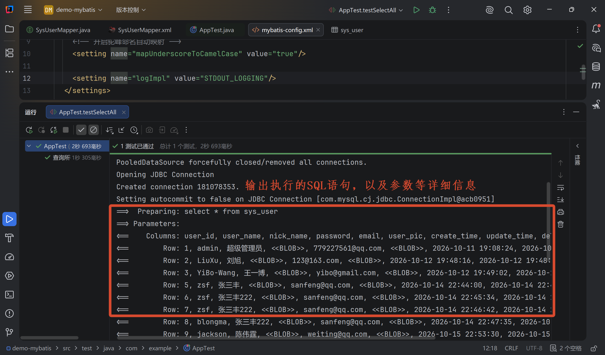
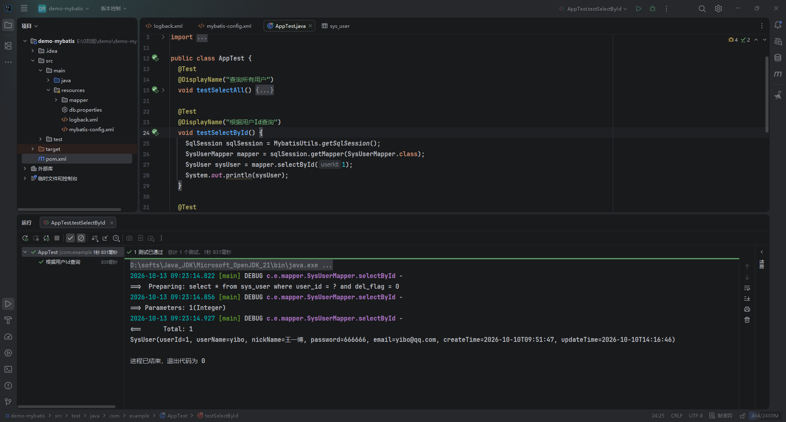

# 日志配置

在 MyBatis 中配置日志主要包含两步：指定日志实现框架 和 调整日志级别以输出SQL及参数。

MyBatis 内置支持多种日志实现，寻找日志工厂的默认顺序是：`SLF4J` -> `Apache Commons Logging` -> `Log4j2` -> `Log4j` -> `JDK logging` -> `STDOUT_LOGGING`（标准控制台输出） -> `NO_LOGGING`。


## 控制台日志

控制台日志用于在控制台中通过 `system.out.printf()` 的方式输出日志，配置非常简单，只需要在 `<setting>` 中配置即可。

```xml {8}
<?xml version="1.0" encoding="UTF-8" ?>
<!DOCTYPE configuration
        PUBLIC "-//mybatis.org//DTD Config 3.0//EN"
        "https://mybatis.org/dtd/mybatis-3-config.dtd">
<configuration>
  <settings>
    <setting name="mapUnderscoreToCamelCase" value="true"/>
    <!-- 无需外部依赖，直接打印到控制台中 -->
    <setting name="logImpl" value="STDOUT_LOGGING"/>
  </settings>
</configuration>
```




## logback 日志

首先，引入 logback 日志依赖：

```xml
<dependencies>
  <dependency>
    <groupId>ch.qos.logback</groupId>
    <artifactId>logback-classic</artifactId>
    <version>1.6.5</version>
  </dependency>
</dependencies>
```

然后在核心配置文件 `mybatis-config.xml` 的 `<settings>` 中指定 `logImpl`：

::: code-group

```xml {9} [mybatis-config.xml]
<?xml version="1.0" encoding="UTF-8" ?>
<!DOCTYPE configuration
        PUBLIC "-//mybatis.org//DTD Config 3.0//EN"
        "https://mybatis.org/dtd/mybatis-3-config.dtd">
<configuration>
  <settings>
    <setting name="mapUnderscoreToCamelCase" value="true"/>
    <!-- 使用 SLF4J 配合 logback.xml 输出日志 -->
    <setting name="logImpl" value="SLF4J"/>
  </settings>
</configuration>
```

```xml [logback.xml]
<?xml version="1.0" encoding="UTF-8"?>
<configuration>
  <property name="CONSOLE_LOG_PATTERN"
            value="%cyan(%d{yyyy-MM-dd HH:mm:ss.SSS}) %green([%thread]) %highlight(%-5level) %boldMagenta(%logger{36}) - %n%msg%n"/>

  <appender name="CONSOLE" class="ch.qos.logback.core.ConsoleAppender">
    <encoder>
      <pattern>${CONSOLE_LOG_PATTERN}</pattern>
      <charset>UTF-8</charset>
    </encoder>
  </appender>

  <!-- 针对整个 Mapper 包开启 DEBUG 日志 -->
  <logger name="com.example.mapper" level="DEBUG"/>

  <!-- 或者只针对某一个具体的 Mapper 开启 DEBUG 日志 -->
  <!-- <logger name="com.example.mapper.UserMapper" level="DEBUG"/> -->

  <root level="INFO">
    <appender-ref ref="CONSOLE"/>
  </root>
</configuration>
```

:::

> [!NOTE] 提示
>
> `logback.xml` 的配置内容，和在 SpringBoot 中配置日志的方式一样。



