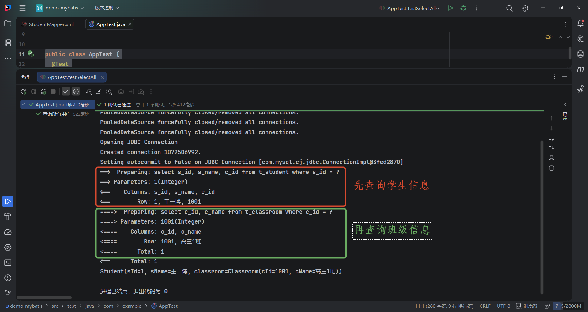

# 复杂关联

首先，创建 2 张表，一张学生表和一张班级表，多对一体现在 **多个学生对应一个班级**，而一对多体现在 **一个班级对应多个学生**。

```sql
-- 班级表
CREATE TABLE `t_classroom` (
  `c_id` int(11) NOT NULL COMMENT '班级ID',
  `c_name` varchar(255) NOT NULL COMMENT '班级名称',
  PRIMARY KEY (`c_id`)
) ENGINE=InnoDB DEFAULT CHARSET=utf8mb4 COLLATE=utf8mb4_0900_ai_ci;

INSERT INTO `mybatis`.`t_classroom` (`c_id`, `c_name`) VALUES (1001, '高三1班');
INSERT INTO `mybatis`.`t_classroom` (`c_id`, `c_name`) VALUES (1002, '高三2班');

-- 学生表
CREATE TABLE `t_student` (
  `s_id` int(11) NOT NULL COMMENT '学生ID',
  `s_name` varchar(255) NOT NULL COMMENT '学生名字',
  `c_id` int(11) NOT NULL COMMENT '所属班级',
  PRIMARY KEY (`s_id`),
  KEY `pk_c_id` (`c_id`),
  CONSTRAINT `pk_c_id` FOREIGN KEY (`c_id`) REFERENCES `t_classroom` (`c_id`)
) ENGINE=InnoDB DEFAULT CHARSET=utf8mb4 COLLATE=utf8mb4_0900_ai_ci;

INSERT INTO `mybatis`.`t_student` (`s_id`, `s_name`, `c_id`) VALUES (1, '王一博', 1001);
INSERT INTO `mybatis`.`t_student` (`s_id`, `s_name`, `c_id`) VALUES (2, '陈伟霆', 1001);
INSERT INTO `mybatis`.`t_student` (`s_id`, `s_name`, `c_id`) VALUES (3, '迪丽热巴', 1001);
INSERT INTO `mybatis`.`t_student` (`s_id`, `s_name`, `c_id`) VALUES (4, '张起灵', 1002);
INSERT INTO `mybatis`.`t_student` (`s_id`, `s_name`, `c_id`) VALUES (5, '古巨基', 1002);
```


## 多对一处理

### 级联属性

级联属性是处理多对一最简单的方式，直接通过 `classroom.cId` 的方式，把查询的数据进行赋值。

::: code-group

```xml [StudentMapper.xml] {10,11}
<?xml version="1.0" encoding="UTF-8"?>
<!DOCTYPE mapper
        PUBLIC "-//mybatis.org//DTD Mapper 3.0//EN"
        "https://mybatis.org/dtd/mybatis-3-mapper.dtd">
<mapper namespace="com.example.mapper.StudentMapper">
  <resultMap id="studentResultMap" type="com.example.pojo.Student">
    <id property="sId" column="s_id" />
    <result property="sName" column="s_name" />
    <!-- 方式一：级联属性 -->
    <result property="classroom.cId" column="c_id" />
    <result property="classroom.cName" column="c_name" />
  </resultMap>

  <select id="selectBySid" resultMap="studentResultMap">
    select
      s.s_id, s.s_name, c.c_id, c.c_name
    from
      t_student s
    join
      t_classroom c
    on
      s.c_id = c.c_id
    where
      s.s_id = #{sid}
  </select>
</mapper>
```

```java [StudentMapper]
public interface StudentMapper {
  Student selectBySid(Integer sid);
}
```

```java [Student] {12}
@Data
@NoArgsConstructor
@AllArgsConstructor
public class Student {
  private Integer sId;

  private String sName;

  // private Integer cId;

  // 学生关联班级
  private Classroom classroom;
}
```

```java [Classroom]
@Data
@NoArgsConstructor
@AllArgsConstructor
public class Classroom {
  private Integer cId;

  private String cName;
}
```

```java [单元测试]
public class AppTest {
  @Test
  void testSelectAll() {
    SqlSession sqlSession = MybatisUtils.getSqlSession();
    StudentMapper mapper = sqlSession.getMapper(StudentMapper.class);
    Student student = mapper.selectBySid(1);
    System.out.println(student);
  }
}
```

:::


### association

`<association>` 也是处理 “多对一” 进行关联的一种方式。它负责告诉 MyBatis：当前实体对象里有一个属性，是另一个实体对象，需要把数据库里关联的数据映射进来。

```xml [StudentMapper.xml] {10-13}
<?xml version="1.0" encoding="UTF-8"?>
<!DOCTYPE mapper
        PUBLIC "-//mybatis.org//DTD Mapper 3.0//EN"
        "https://mybatis.org/dtd/mybatis-3-mapper.dtd">
<mapper namespace="com.example.mapper.StudentMapper">
  <resultMap id="studentResultMap" type="com.example.pojo.Student">
    <id property="sId" column="s_id" />
    <result property="sName" column="s_name" />
    <!-- 方式二：association 关联 -->
    <association property="classroom" javaType="com.example.pojo.Classroom">
      <id property="cId" column="c_id"/>
      <result property="cName" column="c_name"/>
    </association>
  </resultMap>

  <select id="selectBySid" resultMap="studentResultMap">
    select
      s.s_id, s.s_name, c.c_id, c.c_name
    from
      t_student s
    join
      t_classroom c
    on
      s.c_id = c.c_id
    where
      s.s_id = #{sid}
  </select>
</mapper>
```


### 分步查询

分布查询（也叫嵌套查询）是 MyBatis 处理关联对象的一种独特方式：先查主表，再根据主表结果中的外键值，触发第二次查询去加载关联对象。


首先，需要创建 班级表 根据 `cid` 进行查询的接口：

::: code-group

```xml [ClassroomMapper.xml]
<?xml version="1.0" encoding="UTF-8"?>
<!DOCTYPE mapper
        PUBLIC "-//mybatis.org//DTD Mapper 3.0//EN"
        "https://mybatis.org/dtd/mybatis-3-mapper.dtd">
<mapper namespace="com.example.mapper.ClassroomMapper">
  <select id="selectByCid" resultType="com.example.pojo.Classroom">
    select c_id, c_name from t_classroom where c_id = #{cid}
  </select>
</mapper>
```

```java [ClassroomMapper]
public interface ClassroomMapper {
  Classroom selectByCid(Integer cid);
}
```

:::

然后，在 学生表 的查询中，通过 `association` 指定分步查询的接口，以及要传入的参数：

::: code-group

```xml [StudentMapper.xml] {14}
<?xml version="1.0" encoding="UTF-8"?>
<!DOCTYPE mapper
        PUBLIC "-//mybatis.org//DTD Mapper 3.0//EN"
        "https://mybatis.org/dtd/mybatis-3-mapper.dtd">
<mapper namespace="com.example.mapper.StudentMapper">
  <resultMap id="studentResultMap" type="com.example.pojo.Student">
    <id property="sId" column="s_id"/>
    <result property="sName" column="s_name"/>

    <!--
      select: 指定分步查询时，第二次要调用的方法
      column: 把 cid 当作参数传递给 selectByCid 方法，实现二次查询
     -->
    <association property="classroom" select="com.example.mapper.ClassroomMapper.selectByCid" column="c_id"/>
  </resultMap>

  <select id="selectBySid" resultMap="studentResultMap">
    select s_id, s_name, c_id from t_student where s_id = #{sid}
  </select>
</mapper>
```

```java [单元测试]
public class AppTest {
  @Test
  void testSelectAll() {
    SqlSession sqlSession = MybatisUtils.getSqlSession();
    StudentMapper mapper = sqlSession.getMapper(StudentMapper.class);
    Student student = mapper.selectBySid(1);
    System.out.println(student);
  }
}
```

:::




#### 延迟加载

>🤔 现在的分步查询每次都会 **默认将班级信息查询出来**，如果我只需要查询 学生信息，并不想要查询 班级信息，那么该如何优化？

这种情况需要借助 `fetchType` 属性实现 **延迟加载**（也叫懒加载）：

::: code-group

```xml [StudentMapper.xml] {15}
<?xml version="1.0" encoding="UTF-8"?>
<!DOCTYPE mapper
        PUBLIC "-//mybatis.org//DTD Mapper 3.0//EN"
        "https://mybatis.org/dtd/mybatis-3-mapper.dtd">
<mapper namespace="com.example.mapper.StudentMapper">
  <resultMap id="studentResultMap" type="com.example.pojo.Student">
    <id property="sId" column="s_id"/>
    <result property="sName" column="s_name"/>

    <!--
       fetchType: 指定分步查询的模式，它有两个可选值：
          - lazy: 懒加载机制，只有用到 班级信息 时，才进行分步查询
          - eager: 始终执行分步查询
     -->
    <association property="classroom" select="com.example.mapper.ClassroomMapper.selectByCid" column="c_id" fetchType="lazy"/>
  </resultMap>

  <select id="selectBySid" resultMap="studentResultMap">
    select s_id, s_name, c_id from t_student where s_id = #{sid}
  </select>
</mapper>
```

```java [单元测试]
public class AppTest {
  @Test
  void testSelectAll() {
    SqlSession sqlSession = MybatisUtils.getSqlSession();
    StudentMapper mapper = sqlSession.getMapper(StudentMapper.class);
    Student student = mapper.selectBySid(1);
    // 只用到了 学生信息，此时不会进行分步查询
    System.out.println(student.getSName());
    // 此时用到了 班级信息，才会进行分步查询
    System.out.println(student.getClassroom().getCName());
  }
}

```

:::

> [!TIP] 全局延迟加载
>
> 也可以在全局设置延迟加载，表示系统内所有的分步查询默认都是延迟加载的：
>
> ```xml {5}
> <settings>
>   <setting name="mapUnderscoreToCamelCase" value="true"/>
> 
>   <!-- 设置分步查询为延迟加载模式 -->
>   <setting name="lazyLoadingEnabled" value="true"/>
> </settings>
> ```
>
> 设置全局延迟加载之后，如果某个接口就不想延迟加载，需要每次都执行分步查询，此时可以给该接口设置 `fetchType="eager"`：
>
> ```xml {11}
> <?xml version="1.0" encoding="UTF-8"?>
> <!DOCTYPE mapper
>         PUBLIC "-//mybatis.org//DTD Mapper 3.0//EN"
>         "https://mybatis.org/dtd/mybatis-3-mapper.dtd">
> <mapper namespace="com.example.mapper.StudentMapper">
>   <resultMap id="studentResultMap" type="com.example.pojo.Student">
>     <id property="sId" column="s_id"/>
>     <result property="sName" column="s_name"/>
> 
>     <!-- 该接口不需要延迟加载 -->  
>     <association property="classroom" select="com.example.mapper.ClassroomMapper.selectByCid" column="c_id" fetchType="eager"/>
>   </resultMap>
> 
>   <select id="selectBySid" resultMap="studentResultMap">
>     select s_id, s_name, c_id from t_student where s_id = #{sid}
>   </select>
> </mapper>
> ```


## 一对多处理

### collection

::: code-group

```xml {10-13} [ClassroomMapper.xml]
<?xml version="1.0" encoding="UTF-8"?>
<!DOCTYPE mapper
        PUBLIC "-//mybatis.org//DTD Mapper 3.0//EN"
        "https://mybatis.org/dtd/mybatis-3-mapper.dtd">
<mapper namespace="com.example.mapper.ClassroomMapper">
  <resultMap id="hasStudentResultMap" type="com.example.pojo.Classroom">
    <id property="cId" column="c_id"/>
    <result property="cName" column="c_name"/>

    <collection property="students" ofType="com.example.pojo.Student">
      <id property="sId" column="s_id"/>
      <result property="sName" column="s_name"/>
    </collection>
  </resultMap>

  <select id="selectHasStudentByCid" resultMap="hasStudentResultMap">
    select
      c.c_id, c.c_name, s.s_id, s.s_name
    from
      t_classroom c
    join
      t_student s
    on
      c.c_id = s.c_id
    where
      s.c_id = 1001
  </select>
</mapper>
```

```java [ClassroomMapper]
public interface ClassroomMapper {
  Classroom selectHasStudentByCid(Integer cid);
}
```

```java [Classroom] {9}
@Data
@NoArgsConstructor
@AllArgsConstructor
public class Classroom {
  private Integer cId;

  private String cName;

  private List<Student> students;
}
```

```java [单元测试]
public class AppTest {
  @Test
  void testSelectAll() {
    SqlSession sqlSession = MybatisUtils.getSqlSession();
    ClassroomMapper mapper = sqlSession.getMapper(ClassroomMapper.class);
    Classroom classroom = mapper.selectHasStudentByCid(1001);
    System.out.println(classroom);
  }
}

```

:::


### 分步查询

::: code-group

```xml [ClassroomMapper.xml] {12-15}
<?xml version="1.0" encoding="UTF-8"?>
<!DOCTYPE mapper
        PUBLIC "-//mybatis.org//DTD Mapper 3.0//EN"
        "https://mybatis.org/dtd/mybatis-3-mapper.dtd">
<mapper namespace="com.example.mapper.ClassroomMapper">

  <resultMap id="hasStudentResultMap" type="com.example.pojo.Classroom">
    <id property="cId" column="c_id"/>
    <result property="cName" column="c_name"/>

    <!-- 分步查询，已经开启了全局 延迟查询 -->
    <collection
                property="students"
                select="com.example.mapper.StudentMapper.selectStudentByCid"
                column="c_id"/>
  </resultMap>

  <select id="selectHasStudentByCid" resultMap="hasStudentResultMap">
    select c_id, c_name from t_classroom where c_id = #{cid}
  </select>
</mapper>
```

```java [ClassroomMapper]
public interface ClassroomMapper {
  Classroom selectHasStudentByCid(Integer cid);
}
```

```xml [StudentMapper.xml]
<?xml version="1.0" encoding="UTF-8"?>
<!DOCTYPE mapper
        PUBLIC "-//mybatis.org//DTD Mapper 3.0//EN"
        "https://mybatis.org/dtd/mybatis-3-mapper.dtd">
<mapper namespace="com.example.mapper.StudentMapper">

  <select id="selectStudentByCid" resultType="com.example.pojo.Student">
    select s_id, s_name, c_id from t_student where c_id = #{cid}
  </select>

</mapper>
```

```java [StudentMapper]
public interface StudentMapper {
  List<Student> selectStudentByCid(Integer cid);
}
```

```java [单元测试]
public class AppTest {
  @Test
  void testSelectAll() {
    SqlSession sqlSession = MybatisUtils.getSqlSession();
    ClassroomMapper mapper = sqlSession.getMapper(ClassroomMapper.class);
    Classroom classroom = mapper.selectHasStudentByCid(1001);
    // 只查询班级信息，就会触发延迟加载
    System.out.println(classroom.getCName());
  }
}
```

:::


