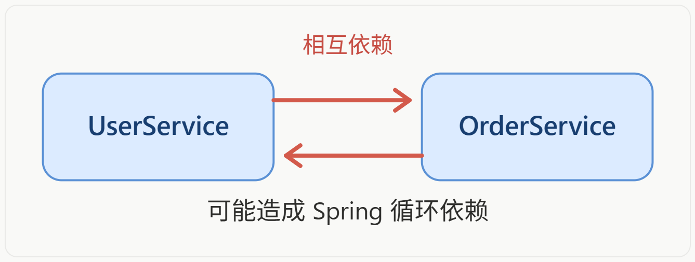

# Db 静态类

Db 静态类的功能和 `IService<T>` 接口几乎相同，但 Db 静态类存在的目的主要是为了 **解决跨 Service 操作数据库时的依赖注入问题**。它可以让开发者不需要注入对应的 Service，也能完成通用的 CRUD 操作。

可以这样理解：

- `IService<T>`：面向业务对象的数据库操作接口；
- `Db`：面向实体类的通用数据库操作工具；


## 循环依赖问题

Db 存在最主要的目的就是为了解决循环依赖的问题。假设有两个 Service，并且他们相互依赖：

```java
@Service
public class UserServiceImpl {
  @Autowired
  private OrderService orderService;
}

@Service
public class OrderServiceImpl {
  @Autowired
  private UserService userService;
}
```



如果 `OrderService` 只是为了查询用户信息才依赖 `UserService`，那么可以改为：

```java {4}
@Service
public class OrderServiceImpl {
  public void createOrder(Long userId) {
    User user = Db.getById(userId, User.class);
  }
}
```

这样就消除了不必要的 Service 依赖，从而也减少了循环依赖出现的概率。


## 基本使用

### 新建订单表

```sql
CREATE TABLE `sys_order` (
  `order_id` bigint NOT NULL COMMENT '订单ID',
  `user_id` bigint NOT NULL COMMENT '用户ID',
  `order_name` varchar(255) DEFAULT NULL COMMENT '订单名称',
  `order_price` decimal(10,0) DEFAULT NULL COMMENT '订单价格',
  PRIMARY KEY (`order_id`)
) ENGINE=InnoDB DEFAULT CHARSET=utf8mb4 COLLATE=utf8mb4_0900_ai_ci;

INSERT INTO `mybatis`.`sys_order` (`order_id`, `user_id`, `order_name`, `order_price`) VALUES (1, 1, '羽绒服', 120);
INSERT INTO `mybatis`.`sys_order` (`order_id`, `user_id`, `order_name`, `order_price`) VALUES (2, 1, '牛仔裤', 87);
INSERT INTO `mybatis`.`sys_order` (`order_id`, `user_id`, `order_name`, `order_price`) VALUES (3, 1, '耐克鞋子', 200);
INSERT INTO `mybatis`.`sys_order` (`order_id`, `user_id`, `order_name`, `order_price`) VALUES (4, 2, '内裤', 35);
INSERT INTO `mybatis`.`sys_order` (`order_id`, `user_id`, `order_name`, `order_price`) VALUES (5, 2, 'iPhone17', 5999);
```


## 查询功能


::: code-group

```java [SysUserController] {9,15}
@RestController
@RequestMapping("/sysUser")
public class SysUserController {
  @Autowired
  private SysUserService sysUserService;

  @GetMapping("/{userId}")
  public SysUserVO queryUserById(@PathVariable("userId") Long userId) {
    SysUserDTO sysUserDTO = sysUserService.queryUserById(userId);
    return BeanUtil.copyProperties(sysUserDTO, SysUserVO.class);
  }

  @GetMapping
  public List<SysUserVO> queryUserByIds(@RequestParam("userIds") List<Long> userIds) {
    List<SysUserDTO> sysUserDTOS = sysUserService.queryUserByIds(userIds);
    return BeanUtil.copyToList(sysUserDTOS, SysUserVO.class);
  }
}
```

```java [SysUserServiceImpl]
@Service
public class SysUserServiceImpl extends ServiceImpl<SysUserMapper, SysUser> implements SysUserService {
  // 在查询用户的时候，也要把订单查询出来，这就出现依赖了
  // @Autowired // [!code --]
  // private SysOrderService sysOrderService; // [!code --]

  @Override
  public SysUserDTO queryUserById(Long userId) {
    // 先查询用户信息，this 就表示 ServiceImpl，它是 MyBatis-Plus 内置提供的
    SysUser sysUser = this.getById(userId);
    SysUserDTO sysUserDTO = BeanUtil.copyProperties(sysUser, SysUserDTO.class);

    // 通过用户信息中的 userId 再联查订单信息
    // 原本应该调用 sysOrderService.lambdaQuery() 的，但可以使用 Db.lambdaQuery(SysOrder.class) 替代
    List<SysOrder> orders = Db.lambdaQuery(SysOrder.class) // [!code ++]
      .eq(SysOrder::getUserId, userId)
      .list();
    List<SysOrderDTO> sysOrderDTOS = BeanUtil.copyToList(orders, SysOrderDTO.class);

    // 给用户信息中的订单赋值
    sysUserDTO.setSysOrders(sysOrderDTOS);
    return sysUserDTO;
  }

  @Override
  public List<SysUserDTO> queryUserByIds(List<Long> userIds) {
    // 先查询所有用户信息
    List<SysUser> sysUsers = this.listByIds(userIds);
    List<Long> allUserIds = sysUsers.stream().map(SysUser::getUserId).toList();

    // 查询订单信息
    List<SysOrder> sysOrders = Db.lambdaQuery(SysOrder.class) // [!code ++]
      .in(SysOrder::getUserId, allUserIds)
      .list();
    // 将订单信息分组，方便后续获取
    Map<Long, List<SysOrder>> sysOrderMap =
      sysOrders.stream().collect(Collectors.groupingBy(SysOrder::getUserId));

    List<SysUserDTO> sysUserDTOS = BeanUtil.copyToList(sysUsers, SysUserDTO.class);
    for (SysUserDTO sysUserDTO : sysUserDTOS) {
      List<SysOrder> orders = sysOrderMap.get(sysUserDTO.getUserId());
      sysUserDTO.setSysOrders(BeanUtil.copyToList(orders, SysOrderDTO.class));
    }
    return sysUserDTOS;
  }
}
```

:::


