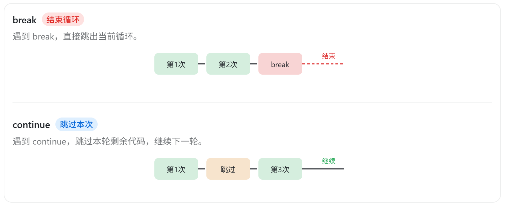

# 流程控制

## 条件判断

条件判断是通过一条或多条语句的执行结果（`True` 或 `False`）来决定执行的代码块。


### if 语句

| 关键字 | 描述                                   | 示例         |
| :----: | -------------------------------------- | :----------- |
|   if   | 条件判断的开始，当条件为 `True` 时执行 | if x > 0:    |
|  elif  | 多条件判断分支（`else if`）            | elif x == 0: |
|  else  | 所有条件都不满足时执行                 | else:        |


```python {3,5,9}
score = int(input("请输入您的成绩："))

if score >= 90:
    print("您的分数等级是 A")
elif score >= 80:
    print("您的分数等级是 B")
elif score >= 70:
    print("您的分数等级是 C")
else:
    print("您的分数等级是 D")
```


### match…case

Python3 新增了 `match` 模式匹配，它是基于某个变量的多个 **固定值进行精确的分支匹配**，并不能完全替代 if 条件判断。

```python {4,17}
score = input("请输入星期几(1-7)：")

# 精确匹配
match score:
    case '1':
        print("周一：工作会议日")
    case '2':
        print("周二：学习培训日")
    case '3':
        print("周三：项目开发日")
    case '4':
        print("周四：代码审查日")
    case '5':
        print("周五：总结规划日")
    case '6' | '7':
        print("周末：放松休息")
    case _: # 当其他 case 都无法匹配时，匹配这条
        print("输入错误")
```


## 循环

### for 循环

Python 中 for 循环可以遍历任何可迭代对象，如一个列表或者一个字符串。

::: code-group

```python [基础使用] {2,9}
# 循环指定次数
for num in range(10):
    print(f"num = {num}")
else:
    print("循环结束")

# 循环字符串
word = "HELLO,WORLD"
for w in word:
    print(w)
else:
    print("循环结束")
```

```python [偶数之和] {4,11}
# 计算 1~100 之间偶数的和
total = 0

for i in range(1, 101): # 生成从 1~100 的序列
    if i % 2 == 0:
        total += i
# 输出结果
print("偶数之和是：", total)
    
# 或者借助 range() 函数的 step，直接生成偶数
for i in range(0, 101, 2): # 每次的步长是 2，i 每次就已经是偶数了，不需要再判断
    total += i
# 输出结果
print("偶数之和是：", total)
```

```python [嵌套循环]
for i in range(3):
    for j in range(2):
        print(i, j)

# 打印九九乘法表
for i in range(1, 10): # 行
    for j in range(1, i + 1): # 列
        print(f"{j} x {i} = {i * j}", end="\t")
    print()
```

:::

> [!NOTE] range 函数
>
> `range()` 函数用来生成连续的数字数列，它遵循 “**左闭右开**” 的原则。
>
> ```python
> # start: 起始值，默认为 0
> # stop: 结束值（不包含）
> # step: 步长，默认 1
> range(start, stop, step)
> ```
>


### while 循环

Python 中没有 do…while 循环，只有 while 循环，且 while 循环可以使用 else 关键字。

::: code-group

```python [基础使用] {3,6}
# 打印 10 遍
i = 0
while i < 10:
    print("人生苦短，我用 Python")
    i += 1
else:  # else分支可有可无
    print("循环结束")
```

```python [偶数之和]
# 计算 1~100 之间偶数的和
total = 0
i = 1

while i <= 100:
    if i % 2 == 0:
        total += i
    i = i + 1
# 输出结果
print("偶数之和是：", total)
```

:::


### break

当执行到 `break` 时，立即跳出当前所在的循环，不再执行后面的循环内容。

```python {3}
for i in range(5):
    if i == 3:
        break  # 直接终止循环
    print(i, end="\t")  #  0	1  2
```


### continue

当执行到 `continue` 时，会结束当前这一轮循环，直接进入下一轮循环。

```python {3,5}
for i in range(5):
    if i == 2:
        continue  # 跳过本地循环，进入下一次循环
    elif i == 4:
        break
    print(i, end="\t")  # 0	 1  3
```

|  |
| :----------------------------------------------------------: |
|                   break 和 continue 对比图                   |


