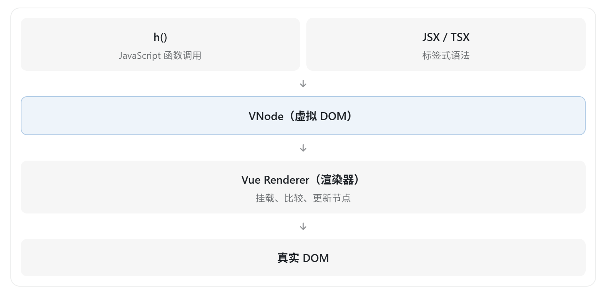

# JSX 语法

JSX 是一种 JavaScript 语法的扩展，允许我们在 JavaScript 代码中使用类似 HTML 的语法来描述页面结构。

需要注意的是，JSX 中的 `<div>` 元素并不是浏览器能直接解析的 HTML，而是会经过编译工具转换为 JavaScript 表达式。在 Vue 中，JSX 通常被转换成创建虚拟 DOM 节点的代码。


## 基本使用

前面学习了 `h()` 和 `render()`，假设需要创建下面的代码结构：

```html
<div class="container">
  <h2>用户信息</h2>
  <p>姓名：张三</p>
  <button>查看详情</button>
</div>
```

使用 JSX 的方式明显可以感觉到代码可阅读性更强：

::: code-group

```typescript [h()]
import { h } from 'vue';

const vnode = h('div', { class: 'container' }, [
  h('h2', '用户信息'),
  h('p', '姓名：张三'),
  h('button', '查看详情'),
]);
```

```typescript [JSX]
const vnode = (
  <div class="container">
    <h2>用户信息</h2>
    <p>姓名：张三</p>
    <button>查看详情</button>
  </div>
);
```

:::


## TSX

TSX 实在 JSX 的基础上结合了 TypeScript，二者的主要区别如下：

|   对比项   |          JSX           |          TSX          |
| :--------: | :--------------------: | :-------------------: |
|  基础语言  |       JavaScript       |      TypeScript       |
| 文件扩展名 |         `.jsx`         |        `.tsx`         |
|  类型检查  | 不提供 TS 静态类型检查 |         支持          |
|  推荐场景  |     JavaScript 项目     | Vue3 + TypeScript 项目 |

::: code-group

```typescript [Counter.tsx]
import { defineComponent, ref } from 'vue';

export default defineComponent({
  name: 'Counter',
  setup() {
    const count = ref<number>(0);

    const increment = () => {
      count.value++;
    };

    return () => (
      <div class="counter">
        <h2>当前计数：{count.value}</h2>
        <button onClick={increment}>
          点击 +1
        </button>
      </div>
    );
  },
});
```

```vue [App.vue]
<template>
	<Counter />
</template>

<script setup lang="ts">
  import Counter from './Counter';
</script>
```

:::




